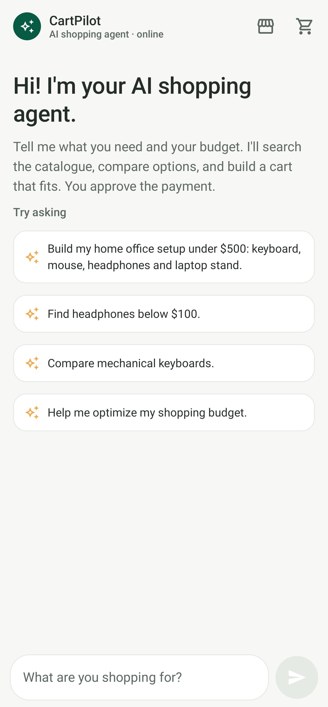
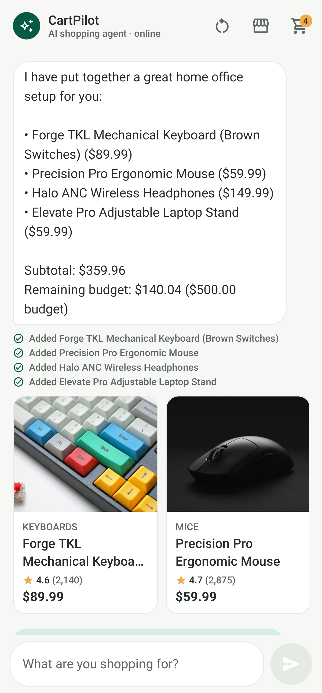
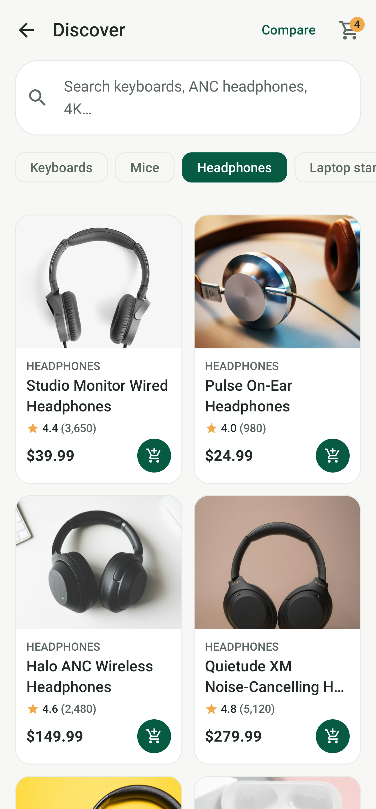
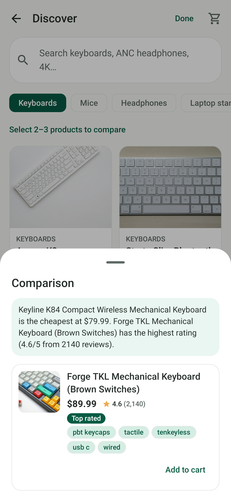
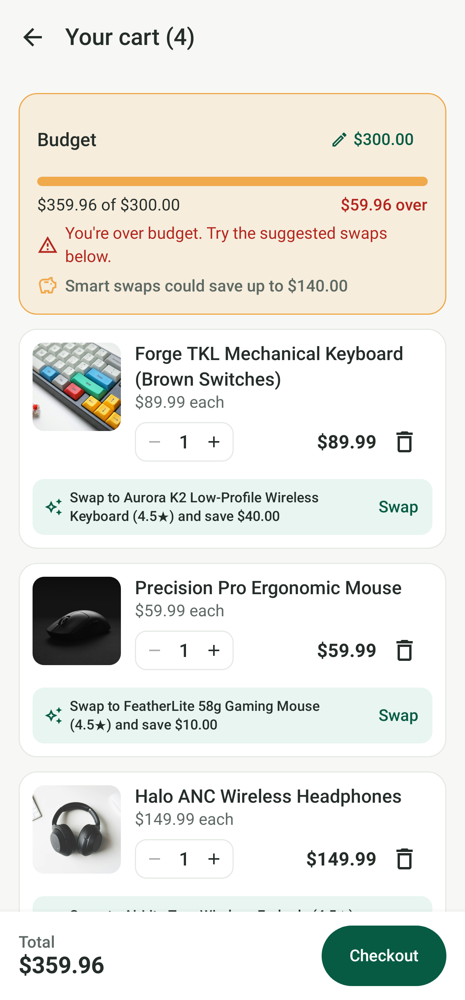
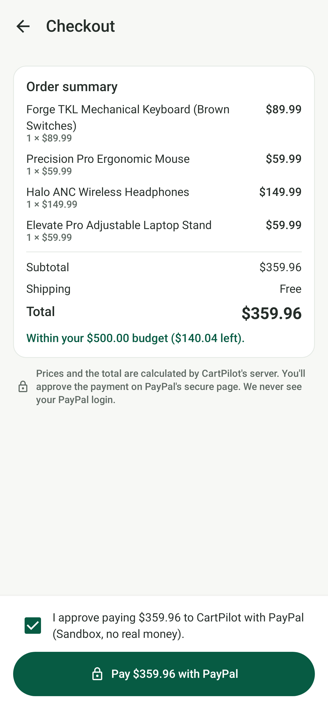
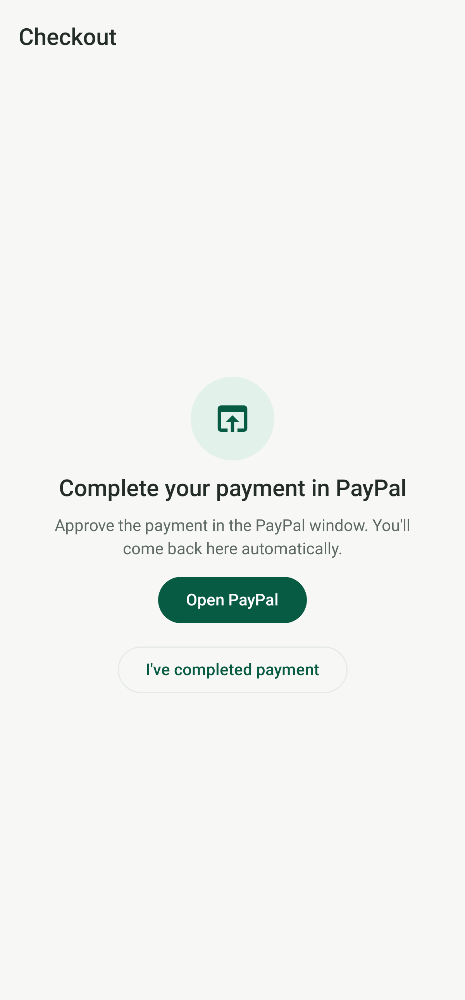
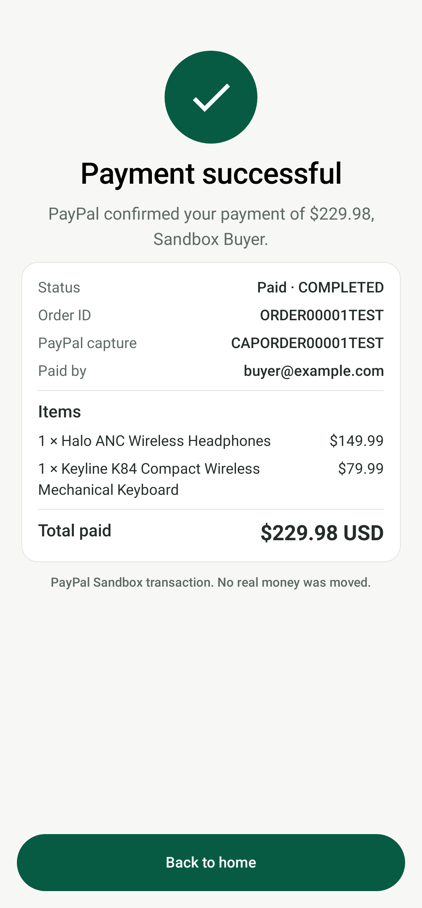
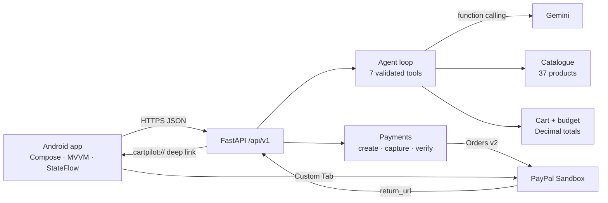

# CartPilot AI

**Your personal AI shopping agent. From intent to checkout.**

Tell CartPilot what you need, for example *"a home office setup under $500: keyboard, mouse, headphones and laptop stand."*

1. A Gemini-powered agent searches a real product catalogue, compares options and builds a cart that fits your budget.
2. You refine the cart by chatting.
3. You check out with **PayPal** (Sandbox) after explicitly approving the payment.

The app shows "Payment successful" only after the backend has captured the order with PayPal and verified the amount.

Android (Kotlin · Jetpack Compose) · FastAPI · Gemini function calling · PayPal Orders v2 · MIT license

| AI chat | Agent-built cart | Discover | Compare |
|---|---|---|---|
|  |  |  |  |

| Smart cart | Checkout | PayPal approval | Verified success |
|---|---|---|---|
|  |  |  |  |

<sub>Screens rendered from the app's real Compose code with Robolectric and Roborazzi (`ScreenshotTest`):

- **Catalogue, cart, budget and comparison data:** real backend responses.
- **Chat reply:** the text Gemini produced in a live test.
- **Receipt:** comes from the test PayPal fake (order `ORDER00001TEST`).</sub>

## Highlights

- **Agentic shopping with real tools.** Gemini function calling drives seven backend tools: `search_products`, `compare_products`, `add_to_cart`, `remove_from_cart`, `replace_product`, `get_cart_summary` and `validate_budget`. One sentence produces a budgeted, explained cart. Follow-ups like *"replace my headphones with something cheaper and keep it under $450"* edit it.
- **Grounded by design.** Products, prices and stock come only from the catalogue. Strict schemas validate every tool argument, and a model-supplied price is rejected. Product cards appear only for items the tools returned *and* the reply names.
- **The backend owns the money.** Totals use exact decimal arithmetic on the server. The PayPal order amount comes from the server cart, and checkout refuses a stale client total.
- **The AI can't pay.** There is no payment tool. The user ticks an approval box, then approves again on PayPal.
- **Verified PayPal checkout.** The backend captures the order with PayPal and checks the order ID, capture status, amount and currency. Capture is idempotent. Cancelled, declined, pending and closed-tab cases each have their own path, and when the app resumes it checks the order's status in case the deep link never arrived.
- **Resilient AI.** Short rate limits are retried using the server's `retryDelay`. If a model's daily quota runs out, the backend falls back across Gemini models. The LLM sits behind a provider interface, so another vendor can be added without changing the shopping workflow.

## Architecture



[docs/ARCHITECTURE.md](docs/ARCHITECTURE.md) has the detailed component diagram, a sequence diagram of one agent turn, and the checkout and verification sequence.

## Repository layout

```
android/   Android app (open this folder in Android Studio)
backend/   FastAPI backend: app/{api,core,schemas,services,repositories}, seed/, static/, tests/
docs/      Plan, architecture, deployment, demo script, Devpost text, screenshots
render.yaml            Render Blueprint (backend deployment)
.github/workflows/     CI: backend tests + Android build/tests/lint
```

## Run the backend locally

Requires Python 3.12.

```bash
cd backend
python -m venv .venv
# Windows: .venv\Scripts\activate    macOS/Linux: source .venv/bin/activate
pip install -r requirements.txt
cp .env.example .env        # then fill in your keys (see below)
python -m uvicorn app.main:app --reload --host 0.0.0.0 --port 8000
```

- Health: http://localhost:8000/api/v1/health
- Interactive API docs: http://localhost:8000/docs
- Tests: `python -m pytest -q`

### Environment variables

| Variable | Purpose |
|---|---|
| `ENVIRONMENT` | `development` / `production` |
| `GEMINI_API_KEY` | Gemini API key ([AI Studio](https://aistudio.google.com/app/apikey)). The free tier allows only about 20 requests per day per model, so enable billing for demos. |
| `GEMINI_MODEL` | Primary model (default `gemini-3.5-flash`) |
| `GEMINI_FALLBACK_MODELS` | Models to try when the primary is rate-limited (default `gemini-3.5-flash-lite,gemini-3.1-flash-lite`) |
| `AI_TIMEOUT_SECONDS` | Timeout per model request (default 60) |
| `PAYPAL_CLIENT_ID`, `PAYPAL_CLIENT_SECRET` | PayPal **Sandbox** REST app credentials |
| `PAYPAL_BASE_URL` | `https://api-m.sandbox.paypal.com` |
| `PUBLIC_BASE_URL` | Public HTTPS URL of the backend, used for PayPal return/cancel. Leave it empty locally (the URL the app called is used); on Render it comes from `RENDER_EXTERNAL_URL` automatically. |
| `ANDROID_DEEP_LINK` | `cartpilot://payment` |

Secrets live only on the backend. `/health` reports whether each integration is configured, never the values.

### API

All routes are under `/api/v1`. Errors use one shape: `{"error": {"code": "...", "message": "...", "details": ...}}`.

| Method | Path | Purpose |
|---|---|---|
| GET | `/health` | Liveness check, plus which integrations are configured |
| GET | `/products?q=&category=&min_price=&max_price=&min_rating=&in_stock=&sort=&limit=` | Search the catalogue (`sort`: `relevance`, `price_asc`, `price_desc`, `rating`) |
| GET | `/products/categories` | Categories with product counts |
| GET | `/products/compare?ids=kb-003,kb-005` | Compare 2–5 products |
| GET | `/products/{id}` | One product |
| GET / DELETE | `/cart/{session_id}` | Get or clear the cart |
| POST | `/cart/{session_id}/items` | `{"product_id", "quantity"}` |
| PATCH / DELETE | `/cart/{session_id}/items/{product_id}` | Set the quantity (`0` removes it) or remove the item |
| POST | `/cart/{session_id}/replace` | `{"old_product_id", "new_product_id"}` |
| PUT | `/cart/{session_id}/budget` | `{"amount": 500}` sets a budget; `null` clears it |
| GET | `/cart/{session_id}/budget-check?budget=` | Within-budget check plus cheaper-swap suggestions |
| POST | `/agent/chat` | `{"session_id", "message"}` → agent reply, product cards, actions taken, cart, budget |
| DELETE | `/agent/sessions/{session_id}` | Reset the conversation (the cart is kept) |
| POST | `/payments/create-order` | `{"session_id", "expected_total", "user_confirmed": true}` → PayPal `order_id` and `approve_url` |
| POST | `/payments/capture-order` | `{"session_id", "order_id"}` → captures and verifies with PayPal, returns a receipt (idempotent) |
| GET | `/payments/orders/{order_id}?session_id=` | Status from PayPal (`can_capture` once the buyer approves) |
| GET | `/payments/paypal/return`, `/payments/paypal/cancel` | Pages PayPal redirects to; they hand control back to the app and never capture |

### PayPal Sandbox checkout

1. The user ticks the approval box and taps **Pay**. The app sends `create-order` with the total it showed. The backend recomputes the total from its own cart and refuses if the two don't match. It then creates an Orders v2 order (`intent=CAPTURE`) for the **server-computed** amount.
2. The app opens `approve_url` in a Chrome Custom Tab. After approving or cancelling, PayPal redirects to the backend's return or cancel page. That page sends the user back to the app via `intent://` or `cartpilot://payment/...`.
3. The app calls `capture-order`. The backend captures and verifies the order ID, `COMPLETED` status, amount and currency, then returns a receipt. A deep link on its own never counts as payment.
4. If the redirect never arrives, the app checks `GET /payments/orders/{id}` when it resumes and captures if PayPal reports `APPROVED`.

**Sandbox setup:** create a REST app at [developer.paypal.com](https://developer.paypal.com/dashboard/applications/sandbox) and put its client ID and secret in `backend/.env`. Pay with the **personal** sandbox account under *Sandbox → Accounts*. No real money moves.

## Run the Android app

Requirements: Android Studio (recent, bundles JDK 25) and Android SDK 36. The app runs on Android 8.0 (API 26) and up.

1. Open the `android/` folder in Android Studio and let Gradle sync.
2. Start the backend (above).
3. **Emulator:** run the `app` configuration. Debug builds call `http://10.0.2.2:8000/`, which is your computer as seen from the emulator.
4. **Physical phone:** run `adb reverse tcp:8000 tcp:8000` and add `cartpilot.apiBaseUrl=http://localhost:8000/` to `android/local.properties`.
5. **Release APK** (calls the deployed HTTPS backend): `./gradlew assembleRelease`, which produces `app/build/outputs/apk/release/app-release.apk`.

## Testing

| Suite | Command | What it covers |
|---|---|---|
| Backend (106 tests) | `cd backend && python -m pytest -q` | Catalogue integrity, search and compare, cart maths and budget, the agent loop with a scripted LLM (tool validation, errors, bounds), Gemini retries and fallback, and PayPal create, capture and verify (including mismatch, pending, declined, idempotency and cancel) against an in-memory fake PayPal |
| Android (24 tests) | `cd android && ./gradlew testDebugUnitTest` | Chat and checkout ViewModels (every payment path, deep link vs. resume, no double capture), plus API contract tests that decode real backend responses |
| Screenshots | `./gradlew testDebugUnitTest -PrecordScreenshots --tests "*ScreenshotTest*"` | Renders all screens to `docs/screenshots` |
| CI | GitHub Actions | Backend tests + Android `assembleDebug testDebugUnitTest lintDebug` on every push |

Regenerate the API contract fixtures after changing the backend schemas: `cd backend && python scripts/export_api_fixtures.py`.

## Deployment

The backend deploys to Render with the `render.yaml` Blueprint. Release builds call `https://cartpilot-api.onrender.com/`. See [docs/DEPLOYMENT.md](docs/DEPLOYMENT.md) for the steps, cold-start notes and free-plan limits.

## Project status

The backend, agent, PayPal integration and all five Android screens are implemented and covered by the tests above. Verified live so far:

- Gemini agent conversations
- PayPal Sandbox order creation
- the error paths

Still to do before submission: a full on-device run against the deployed backend, ending in a buyer-approved Sandbox capture. Progress is tracked in [docs/PLAN.md](docs/PLAN.md).

## Docs

- [Architecture and sequence diagrams](docs/ARCHITECTURE.md)
- [Deployment](docs/DEPLOYMENT.md)
- [Demo script (under 3 minutes)](docs/DEMO_SCRIPT.md)
- [Devpost description](docs/DEVPOST.md)
- [Product image credits](docs/IMAGE_CREDITS.md)

## License

[MIT](LICENSE)
