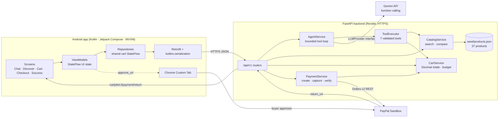
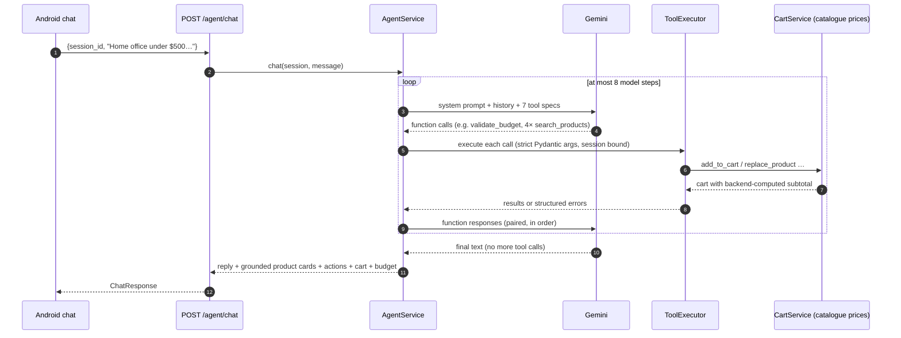
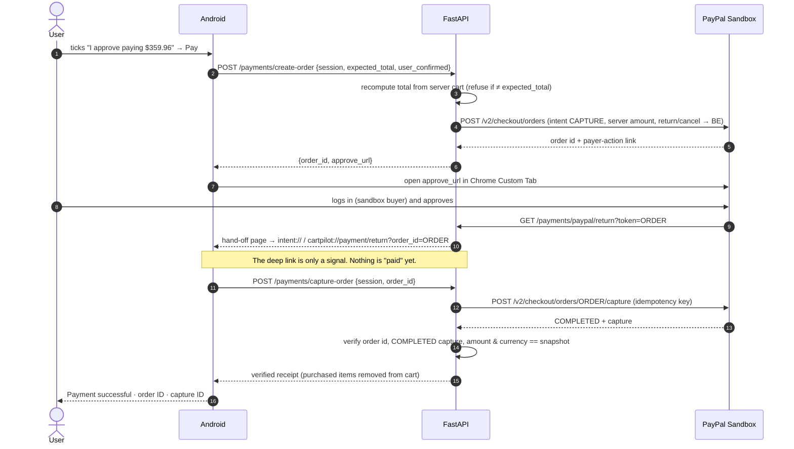

# CartPilot AI: architecture

## System overview

## One agent turn

Guardrails:

- **Seven tools only:** `search_products`, `compare_products`, `add_to_cart`, `remove_from_cart`, `replace_product`, `get_cart_summary`, `validate_budget`. No payment, SQL, shell or network tool exists.
- **Strict arguments:** extra fields such as a model-supplied `price` are rejected. Product IDs must exist, quantities must be 1–10, and out-of-stock items can't be added.
- **Grounded product cards:** the app only gets cards for catalogue products that a tool returned this turn *and* that the reply names.
- **Backend-computed totals:** the model reads subtotals from tool results and never calculates them itself.
- **Rate limits:** a short 429 is retried after Google's `retryDelay`. A daily-quota 429 puts that model in cooldown and the backend falls back to the next model.

## Checkout and payment verification

**If the deep link never arrives** (the tab was closed or the browser blocked the custom scheme), the app calls `GET /payments/orders/{id}` when it resumes:

- `APPROVED` → capture
- `COMPLETED` → receipt
- anything else → "Payment not completed", with options to reopen PayPal or start over

Capture is idempotent, so a deep link and the resume check together can't charge twice.

## Code map

| Area | Path |
|---|---|
| Android screens | `android/app/src/main/java/com/cartpilot/ui/{home,products,cart,checkout,success}` |
| Android data layer | `…/data/{model,remote,repository}`, `…/domain/{model,repository}`, `…/core` |
| API routers | `backend/app/api/` |
| Agent | `backend/app/services/ai/` (`provider.py`, `gemini_provider.py`, `tools.py`, `agent_service.py`, `prompts.py`) |
| Catalogue and cart | `backend/app/services/products/`, `backend/app/services/cart/`, `backend/seed/products.json` |
| Payments | `backend/app/services/payments/` (`paypal_client.py`, `payment_service.py`) |
| Tests | `backend/tests/` (pytest, fake PayPal, scripted LLM), `android/app/src/test/` (ViewModels, API contract, screenshots) |
